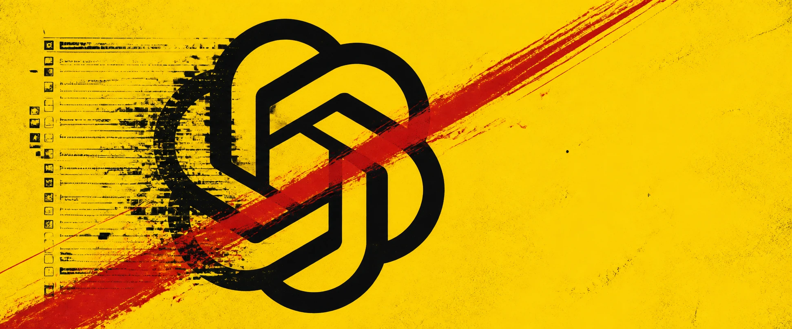

<p align="center">
  
</p>

<h1 align="center">KILL APPS</h1>

<p align="center">
  Codex, DeepSeek Harness, Hermes Desktop, Amnezia, Discord или Chrome — завершить всё дерево процессов одним кликом.
</p>

<p align="center">
  <a href="https://github.com/evgyur/kill-codex/releases/latest/download/Kill-Codex.exe"><strong>Скачать для Windows 11</strong></a>
  ·
  <a href="#что-завершает-каждая-кнопка">Что завершает</a>
  ·
  <a href="#сборка-из-исходников">Собрать самому</a>
</p>

---

Некоторые приложения оставляют после закрытия целое дерево фоновых процессов. Kill Apps завершает выбранную группу сразу — без диспетчера задач, PowerShell и вылавливания каждого PID вручную.

В окне шесть отдельных кнопок с логотипами:

- **KILL CODEX**
- **KILL AMNEZIA**
- **KILL DISCORD**
- **KILL CHROME**
- **KILL DSH**
- **KILL HERMES**

Нажатие выполняется сразу, без дополнительного подтверждения. После операции приложение показывает завершённые процессы, остановленные службы и отдельные ошибки.

## Что завершает каждая кнопка

| Кнопка | Прямые цели | Дополнительно |
|---|---|---|
| `KILL CODEX` | `ChatGPT.exe`, `codex.exe`, `codex-*` | Все дочерние процессы |
| `KILL AMNEZIA` | `AmneziaVPN.exe`, `AmneziaVPN-service.exe`, `AmneziaWG.exe` | Туннельные службы `AmneziaWGTunnel$*`, основная служба `AmneziaVPN-service`, дочерние процессы |
| `KILL DISCORD` | `Discord.exe` | Все дочерние процессы |
| `KILL CHROME` | `chrome.exe` | Все дочерние процессы |
| `KILL DSH` | `DeepSeekDesktop.exe` | Только его дочерние WebView и другие потомки |
| `KILL HERMES` | `hermes-canary.exe` | Все экземпляры Hermes Desktop и их дочерние процессы; отдельный Hermes Agent не затрагивается |

Имена сравниваются без учёта регистра. Приложение не использует опасный поиск по произвольной подстроке: цели каждой кнопки изолированы точным списком и контролируемыми префиксами.

## Как это работает

1. Запустите [`Kill-Codex.exe`](https://github.com/evgyur/kill-codex/releases/latest/download/Kill-Codex.exe).
2. Подтвердите запрос Windows UAC.
3. Нажмите нужную кнопку.
4. Посмотрите результат в нижней части окна.

> [!WARNING]
> Несохранённые данные выбранного приложения могут быть потеряны. `KILL CODEX` намеренно завершает `ChatGPT.exe`; `KILL DSH` — `DeepSeekDesktop.exe`; `KILL HERMES` — все экземпляры Hermes Desktop; `KILL CHROME` закрывает все окна и профили Chrome; `KILL AMNEZIA` отключает активный VPN-туннель.

## Почему нужны права администратора

Повышенные права необходимы для надёжного завершения процессов с разными уровнями доступа и остановки служб Amnezia. Обычный запуск запрашивает UAC перед показом главного окна; безопасный `--dry-run` работает без повышения прав.

## Безопасная проверка

Режим `--dry-run` только показывает найденные цели. Он не открывает процессы с правом завершения и не посылает службам команду остановки.

```powershell
Kill-Codex.exe --dry-run
Kill-Codex.exe --dry-run codex
Kill-Codex.exe --dry-run amnezia
Kill-Codex.exe --dry-run discord
Kill-Codex.exe --dry-run chrome
Kill-Codex.exe --dry-run dsh
Kill-Codex.exe --dry-run hermes
```

Без указания цели проверяется Codex — это сохраняет совместимость с предыдущей версией. Неизвестные или лишние аргументы отклоняются с подсказкой по синтаксису.

## Сборка из исходников

Нужны [Rust](https://rustup.rs/), [Zig](https://ziglang.org/) и Windows 10/11 x64.

```powershell
git clone https://github.com/evgyur/kill-codex.git
cd kill-codex
rustup default stable-x86_64-pc-windows-gnu
cargo build --release
```

Готовый автономный файл появится в `target/release/kill-codex.exe`. Для запуска не нужны Rust, .NET или дополнительные библиотеки.

## Что внутри

- Rust и прямые вызовы Win32 API;
- нативный интерфейс с шестью owner-drawn кнопками, векторными и оригинальными встроенными логотипами;
- двухснимочная проверка дерева процессов и закрепление process handles перед завершением;
- ограниченное по времени подтверждение остановки процессов и служб;
- фоновый worker, поэтому окно продолжает перерисовываться во время операции;
- один автономный `.exe`, без установки, телеметрии, фонового агента и сетевых запросов.

## Дисклеймер

Это неофициальная утилита. Используйте её только для собственных процессов и учитывайте, что принудительное завершение не даёт приложениям сохранить несохранённые данные.
