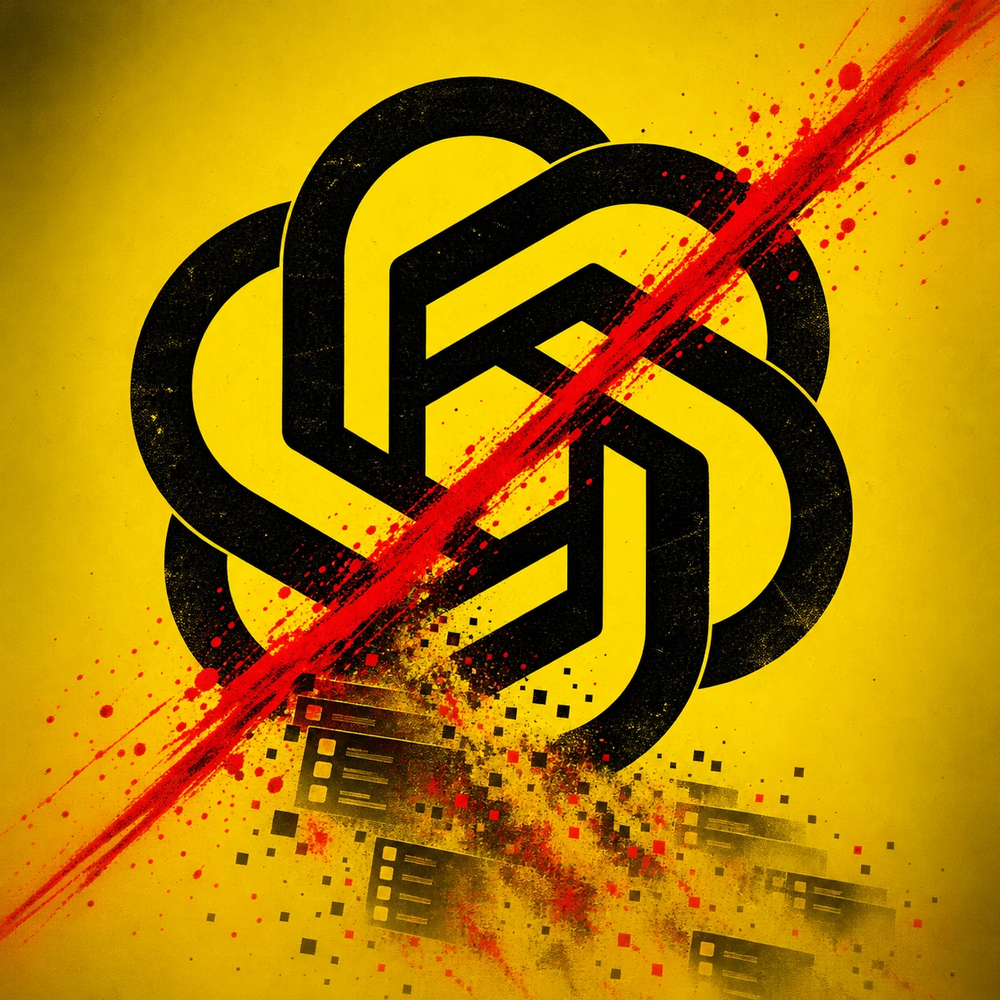

<p align="center">
  
</p>

<h1 align="center">KILL CODEX</h1>

<p align="center">
  Один клик. Ноль зависших процессов.
</p>

<p align="center">
  <a href="https://github.com/evgyur/kill-codex/releases/latest/download/Kill-Codex.exe"><strong>Скачать для Windows 11</strong></a>
  ·
  <a href="#как-это-работает">Как это работает</a>
  ·
  <a href="#сборка-из-исходников">Собрать самому</a>
</p>

---

Codex умеет многое. Иногда — даже не закрываться.

В диспетчере задач остаётся маленькая армия: `ChatGPT.exe`, `codex.exe`, `codex-code-mode-host`, `codex-computer-use` и другие процессы `codex-*`. Можно вылавливать их по одному. Можно открыть PowerShell. А можно нажать одну красную кнопку.

**Kill Codex завершает всю группу сразу.** Без установки, без настройки, без фонового сервиса.

## Что именно завершает

| Маска процесса | Пример |
|---|---|
| `ChatGPT.exe` | оболочка Codex / ChatGPT Desktop |
| `codex.exe` | основной процесс Codex |
| `codex-*` | `codex-code-mode-host`, `codex-computer-use` и остальные дочерние процессы |

Приложение не висит в фоне и ничего не отправляет в сеть. Запустили, нажали, закрыли.

## Как это работает

1. Скачайте [`Kill-Codex.exe`](https://github.com/evgyur/kill-codex/releases/latest/download/Kill-Codex.exe).
2. Запустите файл и подтвердите запрос Windows UAC.
3. Нажмите **«УБИТЬ ВСЕ ПРОЦЕССЫ CODEX»**.

> [!WARNING]
> Несохранённые данные в текущей сессии Codex могут быть потеряны. Приложение намеренно завершает и `ChatGPT.exe`, поэтому окно Codex/ChatGPT закроется вместе с остальными процессами.

## Почему нужны права администратора

Часть процессов может работать с повышенными правами. Манифест приложения запрашивает UAC, чтобы завершение не остановилось на половине списка.

## Безопасная проверка

Хотите сначала увидеть цели, ничего не завершая:

```powershell
Kill-Codex.exe --dry-run
```

Режим показывает подходящие имена и PID в окне, но не вызывает `Kill()`.

## Сборка из исходников

Нужен [.NET 9 SDK](https://dotnet.microsoft.com/download/dotnet/9.0) и Windows 10/11 x64.

```powershell
git clone https://github.com/evgyur/kill-codex.git
cd kill-codex
dotnet publish -c Release -r win-x64 --self-contained true `
  -p:PublishSingleFile=true `
  -p:IncludeNativeLibrariesForSelfExtract=true `
  -o publish
```

Готовый автономный файл появится в `publish/CodexProcessKiller.exe`. Установленный .NET для запуска не требуется.

## Что внутри

- C# + WinForms;
- один self-contained `.exe`;
- завершение всего дерева каждого найденного процесса;
- отдельный отчёт по успешным завершениям и ошибкам;
- никаких зависимостей, телеметрии и сетевых запросов.

## Дисклеймер

Это неофициальная утилита сообщества. Проект не связан с OpenAI и не одобрен OpenAI. Названия и знаки принадлежат соответствующим правообладателям.

## Лицензия

[MIT](LICENSE). Делайте форк. Меняйте маски. Оставляйте одну кнопку.

<p align="center">
  
</p>
